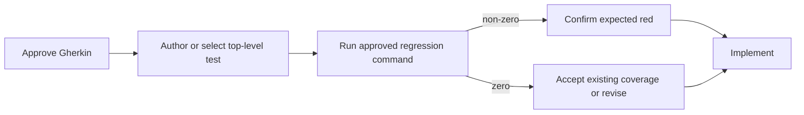

# Conductor Layered TDD

Use this workflow to take one code-changing slice to a reviewed implementation. Initial triage sends clearly bounded changes that need no new or changed tests through a shorter route; other requests use layered TDD. You decide the behavior at Conductor gates; the full route records the resulting state, comment, and evidence in local Markdown artifacts.

## Quick path

```bash
curl -sSfL https://aka.ms/conductor/install.sh | sh
gh auth login
gh skill install microsoft/conductor conductor

ltdd install

conductor run workflows/conductor/layered-tdd.yaml \
  --workspace-instructions \
  --web \
  --input request="Describe the code-changing task"
```

At every gate:

1. Read the linked artifact.
2. Choose the matching option in Conductor.
3. Add an optional comment if you have a caveat, approval reason, or feedback.

Do not edit frontmatter or a dashboard to make the workflow advance. The workflow persists the choice in frontmatter and `## Decision Log` for you.

## How the flow works

```mermaid
flowchart LR
    P["Preflight: test, lint, audit"] --> Graphify{"Build or refresh Graphify?"}
    Graphify --> T{"Fast triage"}
    T -->|"small, no tests needed"| FI["Bounded implementation"]
    FI --> FV["Test, lint, audit"] --> FR["Review and approval"]
    T -->|"standard or uncertain"| R["Requirements"]
    R --> AD["Acceptance design + human gate"]
    AD --> AB["Build AT and support"]
    AB --> AV["Verify readiness, regression and expected red"]
    AV --> AH["Human validates actual acceptance"]
    AH --> M["Layer map"]
    M --> LT["Layer todo and Gherkin"]
    LT --> S["Run approved layer regression"]
    S --> ReviewGate{"Human reviews evidence"}
    ReviewGate -->|"approved"| I["Implementation"]
    ReviewGate -->|"revise"| LT
    I --> V["Test, lint, audit"]
    V --> F["Layer review"]
    F --> AF["Final slice acceptance green"]
    AF --> RF["Final review"]
```



| You do | The workflow does |
| --- | --- |
| Approve, revise, select, stop, or add a concise comment. | Routes to the right task and records the decision. |
| Edit Markdown only to change scope, Gherkin, evidence, or another semantic contract. | Updates frontmatter as compact recovery context for later agents. |
| Review the full-suite result before production code begins. | Runs `test_command` at preflight; the approved regression command during layers and complete slice acceptance at completion. |

## Slice acceptance preparation

| Step | Human checks | Required evidence |
| --- | --- | --- |
| Design | Gherkin, real boundary, model/schema choices, support files, missing pieces and unknowns | `02-slice-acceptance.json`; all questions resolved |
| Design approval | Exact writable files and protected scenario/DSL/driver/fixture files; setup cannot manufacture the outcome | Explicit Conductor decision before support authoring |
| Build and verify | Harness compiles/loads and its data/environment work; unrelated regression stays green | Green readiness/regression plus two runs with the approved behavioral failure |
| Actual validation | Review the real diff, setup semantics and full logs, not only unchanged Gherkin | Explicit Conductor decision before layer mapping |
| Layers | Preserve the approved contract and support; account for models/setup already built | Hash guards plus normal layer gates |
| Finish | Complete behavior works through the real boundary | Green readiness, regression and slice acceptance |

The planner writes the concrete JSON schema described in the installed
`prompts/slice-acceptance-planner.md`. It includes exact file scopes, design and
determinism decisions, a readiness command, a regression command and a focused
acceptance command with its expected assertion marker/exit code. Commands must
exercise the real application boundary; a printed marker or compilation error is
not behavior evidence. These semantics are validated by the human against full
logs; exit codes and markers alone cannot prove them.

The builder may create approved persistence models/schema and precondition
inserts before layers. It cannot implement feature business logic or insert the
expected outcome. Ordinary helpers suffice for the DSL. If the real entry cannot
be exercised without more support, resolve its design before approval; an
undefined helper or unavailable environment blocks progression.

`preservation` mode requires explicit human approval and a justification that no
observable behavior changes (for example a cleanup-only slice); readiness and
regression must still pass. It is not a waiver for an unfinished behavior test.
The fast route remains restricted to work needing no new/changed tests and no
behavior, API, data or migration decisions.

The approval snapshot and full verification logs are local temporary files linked
from Conductor outputs. Keep them for checkpoint recovery. If they disappear,
return through acceptance design and actual validation; approval cannot be
reconstructed from a plan alone. A fresh run with `resume_path` redoes preparation.
The blocked gate never silently reverts changes: review any scope violation and
preserve existing user work before approving a revised baseline. Final failures
can return to layer selection for product fixes. Contract corrections always go
through acceptance design and actual validation again.

## The red-test gate

The layer gate uses the approved regression command: the complete regression suite with only the explicitly pending outer slice acceptance scenarios excluded. The outer acceptance command runs separately; every other failure remains a blocker.



The preflight default is `make test`; acceptance design explicitly approves the later regression command. A non-zero result is captured as evidence rather than aborting the workflow. You still decide whether that failure is the expected contract failure. A zero result can be accepted only as existing coverage; otherwise revise the todo.

## Configuration

| Input | Default | Use |
| --- | --- | --- |
| `request` | required | Code-changing task for one slice. |
| `test_command` | `make test` | Full suite at preflight; basis for the human-approved layer regression command. |
| `lint_command` | `make lint` | Static checks before and after implementation. |
| `security_command` | `make audit` | Dependency/CVE checks before and after implementation. |
| `graphify_scope` | repository root on first build; saved scan root on refresh | Optional code directory to narrow a human-approved Graphify build or refresh. |
| `resume_path` | none | Existing `.github/plans/<slug>` folder to continue. |
| `memory_vault`, `memory_project` | none | Optional Markdown-memory recall and capture. |

## Fast route

The first agent emits `route`, `reason`, `allowed_paths`, and an acceptance criterion. It chooses `fast` only for a documentation correction, small visual adjustment, or localized behavior-preserving refactor when no test must be added or changed and it can name up to three exact files. Uncertain scope and resumed plans use the normal route.

The fast implementor can return to requirements before editing if it discovers that tests or broader design are needed. Preflight has already run. After editing, Conductor checks the changed files against the triage allowlist, then runs the configured test, lint, and security commands. A human reviews the bounded patch and approves or requests a fix. Out-of-boundary edits or failed checks stop at a human gate; the workflow never discards working-tree changes to force a fallback. Fast runs do not create layer-plan or memory artifacts.

Example for a repository with different Make targets:

```bash
conductor run workflows/conductor/layered-tdd.yaml \
  --workspace-instructions \
  --web \
  --input request="Add an audit event for cancelled jobs" \
  --input test_command="make test" \
  --input lint_command="make check" \
  --input security_command="make cve"
```

## Graphify and context control

The workflow now uses explicit context: agents receive only the named inputs
they need. Markdown artifacts and Conductor gates are the durable handoff; raw
verification output is passed only to the layer reviewer.

After preflight and before fast triage, a human gate offers these paths:

| Choice | Result |
| --- | --- |
| Refresh/build | Runs Graphify before requirements. A first build scans repository code by default; `graphify_scope` narrows the scan to a directory such as `src` or `packages/api`. |
| Use existing | Keeps the current graph without spending time on an update. |
| Continue without Graphify | Leaves the workflow fully functional; agents use normal focused repository inspection. |

Graph-enabled discovery, mapping, todo design, test authoring, implementation,
and review query the graph with small response budgets, then verify returned
source locations. Agents never rebuild the graph and never treat an inferred
edge as proof.

Example first build:

```bash
conductor run workflows/conductor/layered-tdd.yaml \
  --workspace-instructions \
  --web \
  --input request="Add an audit event for cancelled jobs" \
  --input graphify_scope="src"
```

## Artifacts and resume

Artifacts live under `.github/plans/` and are local working files. Their frontmatter is compact recovery context for agents; the body is the human–LLM contract and evidence. It does not currently route a new run past completed phases.

| Artifact | Read it when you need to… |
| --- | --- |
| `slice-selection.md` | choose one independently valuable slice. |
| `00-requirements.md` | confirm scope, blockers, and non-goals. |
| `02-slice-acceptance.json` | approve acceptance design, exact support scope, commands and determinism controls before layers. |
| `01-layer-map.md` | choose the next implementation boundary after validating built acceptance. |
| `layers/*.todo.md` | review Gherkin, test evidence, scope, risks, and decisions. |
| `99-final-review.md` | approve completion and optional memory capture. |

Choose the resume path that matches what happened:

| Situation | Use | What it resumes | What it does not do |
| --- | --- | --- | --- |
| The running workflow failed and Conductor saved a checkpoint. | `conductor resume` | The failed agent, with prior workflow outputs and routing state. | It does not reread artifacts to choose a different phase. |
| You are starting a new run against an old plan folder. | `conductor run … --input resume_path=…` | The same `00-requirements.md` path; prevents a sibling folder. | It does not skip preflight or requirements analysis. |

### Resume a failed run

```bash
conductor resume workflows/conductor/layered-tdd.yaml --web
```

Use this first when the run stopped because of a provider, timeout, command, or workflow failure. It is the cheap path: Conductor restores the checkpoint and continues from the failing agent.

### Reopen an existing plan folder

Use `resume_path` when there is no usable Conductor checkpoint, for example when returning another day:

```bash
conductor run workflows/conductor/layered-tdd.yaml \
  --workspace-instructions \
  --web \
  --input request="Resume the active layered TDD slice" \
  --input resume_path=".github/plans/<slice-slug>"
```

This is a new workflow run. It still runs preflight and returns to the requirements griller, which reads and revises the existing `00-requirements.md` in place. Frontmatter provides context to agents today; it does not yet route Conductor past completed phases.

## Installation notes

`ltdd install` copies the workflow, prompts, scripts, and core repo-local Conductor skills. It does not install Conductor itself. Re-running it fills missing files while preserving local edits; `ltdd sync` updates files that still match their last installed hashes and preserves divergent files.

Use Markdown memory only when you need it:

```bash
ltdd install --memory-skills
```

Memory skills are optional. The workflow activates memory only when you also provide its `memory_vault` and `memory_project` inputs.

## Validate before running

```bash
conductor validate workflows/conductor/layered-tdd.yaml
conductor run workflows/conductor/layered-tdd.yaml \
  --dry-run \
  --input request="Smoke test the workflow"
```

For workflow-maintainer details, see [the operator guide](operator-guide.md) and [the original layered TDD notes](design-notes.md).
