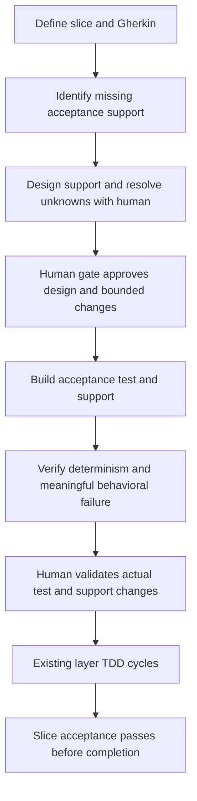
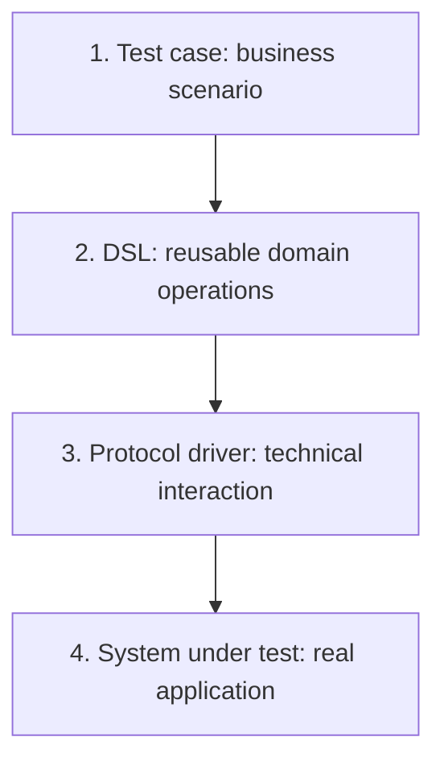

# Handoff: executable slice acceptance before layer implementation

## Objective and authority

Implement the final approach agreed with the human on 2026-11-02. This document authorizes workflow implementation on a separate `codex/` branch; it does not authorize a full benchmark, paid/model-backed diagnostic, merge, or push of that implementation to main.

The user explicitly requested saving all existing local changes and this handoff to remote main first, then delegating implementation and validation to a new agent. Repository artifacts remain in English. User-facing summaries can be Spanish and visual-first.

## Philosophy and original input

The supplied note, reproduced in full in the appendix, describes Dave Farley's acceptance-testing philosophy as reported from a supplied transcript: human-owned executable specifications, meaningful failure before implementing behavior, small reviewed changes, and protection against agents weakening tests. We have the note, not the original transcript; do not present this as independently verified quotations from Farley.

Its four layers organize acceptance-test code: business scenario -> domain DSL -> protocol driver -> real system under test. These are distinct from this repository's architectural implementation layers. Ordinary helpers can implement a DSL; no new framework or parser is required.

The resulting proposal is an outer acceptance cycle for a complete vertical slice, complementing the existing layer-level TDD cycles.

## Final human decision: shift left

A scenario approved on paper is insufficient. Before internal layer implementation starts, resolve the design unknowns and build the functional black-box acceptance test, including its DSL, drivers, and data setup. The test harness must be executable and deterministic; the product behavior under test is expected to remain red.

Earlier proposals to leave DSL implementation until individual layers, or to approve only Gherkin and expected outcomes before layers, were explicitly rejected. Do not implement those alternatives.



| Concern | Required behavior |
|---|---|
| Missing support | Identify DSL operations, protocol drivers, fixtures, isolation, persistence representations and environment needs before implementation. |
| Design uncertainty | Surface modeling and architectural decisions to the human; record decisions and affected boundaries. |
| Early architectural changes | Explicitly permit approved models, schema or persistence support needed for setup, even if they touch later layer boundaries. Account for these changes in the layer map. |
| Scope of setup | Inserting a pending order can establish a precondition. Setting the outcome the scenario is intended to prove bypasses the behavior and is invalid. |
| Approval before support work | Human reviews concrete proposed paths, operations, data representation, assertions and design tradeoffs before authoring changes. |
| Approval after support work | Human reviews actual test, DSL, drivers, fixtures and permitted production/persistence changes plus verification evidence before layer implementation. |
| Determinism | Control data, isolation, cleanup, time and asynchronous observation where applicable. Make repeatability inspectable; do not claim an absolute mathematical guarantee. |
| Meaningful red | Harness must actually execute against the selected real-system boundary and fail for the missing behavior. Missing DSL methods, compilation errors, broken environment and placeholder drivers are blockers, not accepted red evidence. |
| Protection | Preserve approved scenario AND support semantics. Subsequent changes to either require human review; unchanged Gherkin alone is insufficient. |
| Layer cycles | Preserve approved layer boundaries and current layer-specific human/test/red gates. Distinguish the explicitly expected outer acceptance failures from regressions; never ignore arbitrary suite failures. |
| Completion | Execute slice acceptance on connected pieces and require green evidence before declaring completion. |

Reuse existing human-gate patterns and bookkeeping where possible. Avoid extra frameworks, duplicated runnable workflows, speculative generic engines and unnecessary approvals. The workflow must still enforce both human decisions above; choose the smallest clear routing and artifacts that do so. Make any inapplicable acceptance preparation explicit for cleanup/non-behavior work rather than forcing artificial red tests. Preserve existing fast-path safety; ensure behavior changes cannot bypass required slice acceptance through another route.

## Current repository and starting state

Canonical workflow: `bundle/workflows/conductor/`. Distributed skills: `bundle/skills/`. There must remain exactly one canonical runnable workflow tree.

At handoff preparation, checkout was `main`, HEAD `7737da7`. Four pre-existing user-owned modifications were present: `README.md`, `internal/cli/cli.go`, `internal/install/install.go`, `internal/install/install_test.go`. These add selectable Copilot/Claude Agent SDK installation, provider persistence in the manifest, explicit force for provider switches, Claude rendering and tests. They are unrelated to acceptance design and must be preserved. They are being committed and pushed with this handoff before delegation; inspect actual Git state and history rather than treating that old HEAD as the implementation base.

Important integration constraint: Claude rendering in `internal/install/install.go` currently expects exactly 18 reasoning blocks and specific model template markers. Workflow changes may require updating this renderer and meaningful provider tests. Preserve both providers and target-local edit protection; do not merely relax fail-closed checks.

Existing workflow has slice selection/requirements, layer mapping, layer todos with Gherkin, bounded test authoring, human red decisions, layer implementation/review, cleanup routing and a final slice review. The final review currently summarizes verification; that alone does not establish executable whole-slice acceptance. Inspect current sources, not just this description.

## Implementation instructions

1. Read AGENTS.md, README, relevant guides, canonical YAML and affected prompts/scripts/tests. Use Graphify for navigation if available, then verify returned source locations. Inspect every caller affected by routing or output changes.
2. Create `codex/slice-acceptance-before-layers` from the saved main baseline before any implementation edit. Keep unrelated changes intact. Do not merge into main.
3. Implement the preparation/design, human decisions, bounded support authoring, meaningful-red evidence, protection and final-green conditions described above. Update dependent routes, context projections, recorders, templates, skills and documentation only where needed. Existing test author boundaries allow test files only; do not silently bypass them to permit early persistence support. Use an explicit approved scope for this distinct phase.
4. Add focused deterministic tests for gate ordering, blocked/incomplete harness, allowed vs forbidden support edits, regression vs expected-red classification, final acceptance failure, applicable alternate routes, and provider installation compatibility as warranted by the actual implementation. No model-backed benchmark is needed.
5. Run all required validation below and repair failures. Report evidence and remaining limitations honestly.

## Required validation and completion evidence

- `GOCACHE=/tmp/ltdd-go-build go test ./...`
- Install into a temporary repository: `go run ./cmd/ltdd install --target <temp-repository> --memory-skills`.
- Compare its installed workflow tree byte-for-byte with `bundle/workflows/conductor/` for the default provider.
- Run `conductor validate <temp-repository>/workflows/conductor/layered-tdd.yaml` when available (it was available during handoff preparation).
- Check the Claude installation/renderer as appropriate because the starting local changes introduce that supported provider.
- Run focused deterministic workflow/recorder tests relevant to the changes; locate the existing suite and follow its documented invocation.
- `git diff --check`.
- No full benchmark, paid/model-backed diagnostic, or claimed token/cost improvement. Static validation and deterministic tests do not prove end-to-end agent behavior; state that limit.

Deliver a reviewable branch with a concise change summary, validation results, and residual risks. A local implementation commit is allowed; do not push, open a PR or merge unless separately authorized. If a human design decision is genuinely unresolved, present the concrete alternatives and continue independent work; do not invent approval.

## Appendix: original supplied note (verbatim)

# Four-Layer Acceptance Testing: Approach and Tooling

## Context

Dave Farley’s talk argues that AI-assisted development needs human-owned, executable specifications: tests that describe intended behavior and verify it against the real system.

The discussion below distinguishes the approach described in the supplied transcript from our implementation and tooling recommendations.

## The four layers



| Layer | Responsibility | Example |
|---|---|---|
| Test case | Describe business conditions, actions, and expected outcomes | Applying a summer discount reduces the basket total by 10% |
| Domain-specific language (DSL) | Express reusable operations in business vocabulary | `basketWithBookPricedAt()`, `applyDiscount()`, `assertTotalIs()` |
| Protocol driver | Handle interaction through APIs, UI, messaging, or other interfaces | HTTP requests, selectors, serialization, timeouts |
| System under test | Execute the actual application behavior | The bookstore application applies the discount |

The separation keeps business intent at the top and technical coupling below it. An implementation change may require driver changes while leaving the business scenario intact.

## Development workflow

The transcript recommends:

1. Write one human-owned or human-approved scenario.
2. Observe a meaningful failure before implementing the behavior.
3. Let the agent make it pass.
4. Review and commit the small change.
5. Repeat with the next scenario.

Acceptance specifications must be protected from unauthorized changes. An agent deleting or weakening a failing test does not satisfy the intended behavior.

Mutation testing can help identify weak assertions or missing examples. Passing specifications only verifies the behavior those specifications actually cover.

## Is this different from existing acceptance testing?

**Not necessarily. The four layers organize acceptance-test code; they do not automatically introduce a different testing technique.**

| Existing acceptance-test structure | Four-layer equivalent | Potential change |
|---|---|---|
| Acceptance-test method | Test case | None |
| Helper methods inside the test class | DSL | More explicit vocabulary and reuse |
| Database/API interaction in helpers | Protocol driver | Isolation of technical details |
| Application being exercised | System under test | None |

A DSL can consist of ordinary helper methods. It does not require a parser, fluent builder, separate language, or dedicated framework.

Extracting helpers into separate classes is useful when it improves reuse, readability, or maintenance. Moving methods merely to match a diagram adds little.

### Naming alone is insufficient

| Helper | What it expresses |
|---|---|
| `customerHasAnActiveSubscription()` | Business intent |
| `insertSubscriptionRow()` | Storage mechanics |

Putting `insertSubscriptionRow()` in a class called `DSL` does not make the test independent of storage details. The important distinction is the abstraction expressed by the operation.

### Database setup versus behavior under test

Direct database writes can be reasonable for establishing initial conditions.

However, they must not bypass the behavior the scenario intends to verify. Inserting a completed order does not verify that the application can place an order.

The appropriate setup mechanism depends on the chosen test boundary.

## Can plain JUnit implement this?

**Yes. JUnit Jupiter plus ordinary Java helper methods can implement the approach.**

JUnit handles test execution and lifecycle. The test author supplies the domain vocabulary, protocol drivers, and environment setup.

Illustrative scenario:

```java
@Test
void summerDiscountReducesBasketTotalByTenPercent() {
    shop.basketWithBookPricedAt(2000);
    shop.applyDiscount("summer");
    shop.assertTotalIs(1800);
}
```

The amounts above are illustrative integer cents. The helper methods are hypothetical, not an executable implementation.

Using JUnit does not make this a unit test. The boundary exercised by the scenario determines whether it tests a unit, component, or larger system.

## Framework alternatives

These options overlap: several work with JUnit rather than replace it.

| Option | Advantages | Costs and limitations | Best fit |
|---|---|---|---|
| **JUnit + ordinary Java DSL** | Few moving parts; compiler support; straightforward refactoring and debugging | Team maintains DSL conventions; business-readable reporting may require additional work | Developer-owned Java acceptance suites |
| **JUnit + JGiven** | Java scenarios, reusable stages, readable generated reports | Additional stage classes and framework conventions | Developers author scenarios; domain experts review reports |
| **Cucumber-JVM** | Gherkin scenarios separate business examples from implementation; supports example tables | Scenario text and matching step definitions must both be maintained | Business experts actively review or co-author scenarios |
| **Serenity BDD / Screenplay** | Reusable tasks, actors, questions, and reporting; supports UI/API automation | More concepts and infrastructure to learn and maintain | Larger acceptance suites needing consistent automation and reporting |
| **Karate** | Built-in HTTP operations, response matching, reusable flows, and reporting | Another language; scenarios can become coupled to URLs and JSON | API verification as the main testing need |

Official documentation:

- [JUnit](https://docs.junit.org/current/user-guide/)
- [JGiven](https://jgiven.org/)
- [Cucumber](https://cucumber.io/docs/gherkin/reference/)
- [Serenity Screenplay](https://serenity-bdd.github.io/docs/screenplay/screenplay_fundamentals)
- [Karate](https://docs.karatelabs.io/)

## Complementary tools

These address specific responsibilities rather than replace the overall approach.

| Need | Tool | Placement |
|---|---|---|
| HTTP interaction and response validation | [REST Assured](https://rest-assured.io/) | Protocol driver |
| Wait for asynchronous outcomes with a deadline | [Awaitility](https://github.com/awaitility/awaitility/wiki/Usage) | Behind domain operations or assertions |
| Disposable databases, brokers, and dependencies | [Testcontainers](https://java.testcontainers.org/) | Test-environment setup |

Add these only where the application requires their capabilities.

## Recommendation

For an existing Java acceptance suite, first assess what is already working:

- Do scenarios communicate business intent?
- Are technical details contained behind useful helpers?
- Can helpers be reused without creating complicated shared state?
- Do implementation changes unnecessarily break business scenarios?
- Are approved specifications protected from agent changes?

If the existing suite already meets these goals, a formal four-layer restructuring may provide little benefit.

If improvements are needed:

| Observed problem | Smallest useful response |
|---|---|
| Duplicated business setup and actions | Extract reusable domain helpers |
| HTTP, SQL, or UI details scattered through scenarios | Isolate technical interactions in drivers |
| Domain experts need readable reports | Evaluate JGiven |
| Domain experts need to review or author separate scenario text | Evaluate Cucumber |
| A substantial automation suite needs shared structure and reporting | Evaluate Serenity |
| API testing needs extensive built-in protocol features | Evaluate Karate |

**Choose a framework to solve an observed problem. The four-layer model itself does not require one.**

## Source fidelity and limits

The first generated note used secondary material because the video transcript was unavailable. It was rejected and reverted.

The replacement note was produced from the supplied transcript, preserved verbatim. It separates Farley’s claims from our implementation suggestions.

The tooling comparison reflects official documentation and our assessment. We did not inspect the existing acceptance tests, execute the illustrative examples, or verify framework compatibility with a specific project.